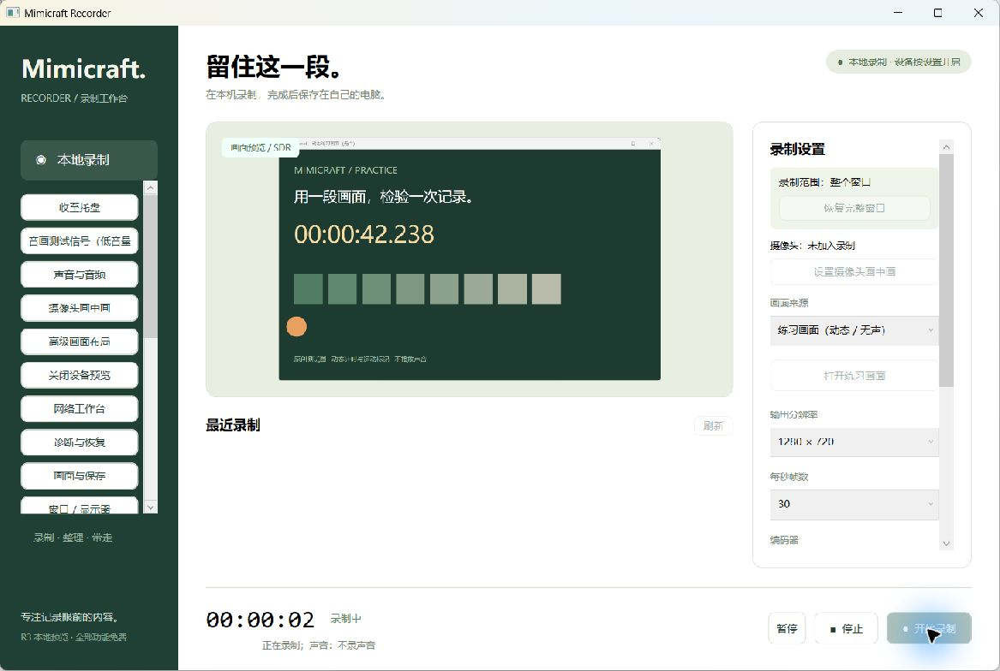
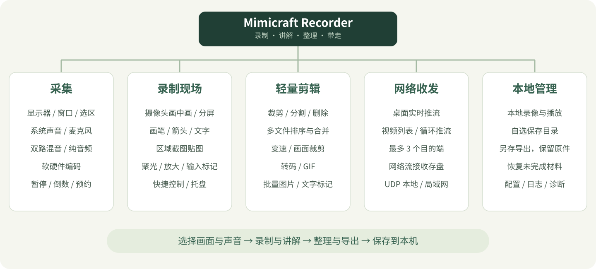
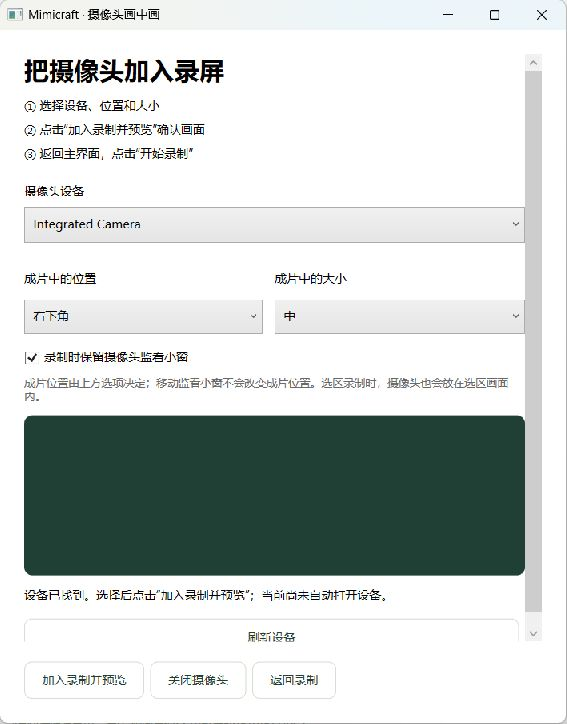
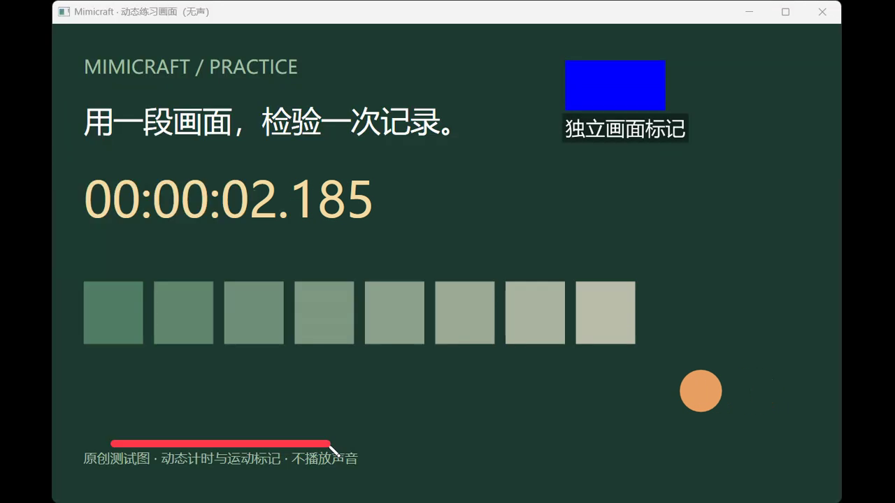
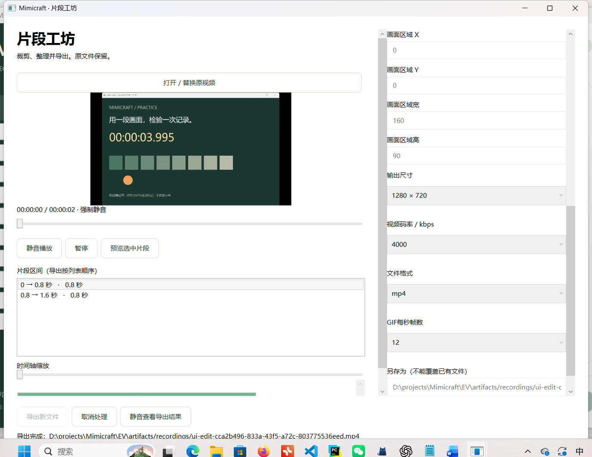

# Mimicraft Recorder

**录下来，讲清楚，再把多余的部分剪掉。**

免费、开源的 Windows 桌面录屏工具。可以录屏、录系统声音和麦克风，放上摄像头小窗，用批注标出重点；录完后直接裁剪、合并、变速或导出 GIF。

不需要账号，没有订阅和强制水印。本地录制、批注和剪辑不依赖云端。网络推流是单独开启的功能。

[](https://github.com/zhangtonghetony/mimicraft-recorder/releases/latest)
[](LICENSE)


[下载 Windows 便携版](https://github.com/zhangtonghetony/mimicraft-recorder/releases/latest) · [功能清单](docs/FEATURES.md) · [开发与构建](docs/DEVELOPMENT.md) · [问题反馈](https://github.com/zhangtonghetony/mimicraft-recorder/issues)



*A free, local-first Windows screen recorder with webcam picture-in-picture, screen annotations, quick editing and streaming. Built with C#, .NET 10 and WPF.*

## 用它做什么

给同事演示一个问题，录一段课程操作，或者留下一次软件使用过程。需要解释时，在屏幕上画线、加箭头、放大细节；录完删掉开头的等待和结尾的空白，就可以把文件发出去。

它把这些常用步骤放在同一个桌面应用里：



| 环节 | 已有功能 |
| --- | --- |
| 选画面 | 显示器、窗口、框选与精确选区；录制中移动取景框；停止后恢复整屏 |
| 选声音 | 系统声音、麦克风、双路混音或不录声；设备选择、独立增益；WAV / M4A / MP3 纯音频 |
| 边录边讲 | 摄像头画中画、画笔/荧光/箭头/文字、撤销重做、区域截图贴图、聚光与 2 倍放大镜 |
| 少切窗口 | 可移动快捷控制、左右键标记、组合键显示、全局快捷键、托盘、倒数与一次性预约 |
| 整理素材 | 时间裁剪、分割与删除、画面裁剪、多文件合并、0.25～4 倍速、转码、GIF、批量图片/文字标记 |
| 需要直播时 | 桌面或文件列表推流、循环播放、最多 3 个目的端、网络流接收存盘、UDP 本地/局域网传输 |
| 留在本机 | 文件列表与播放、自选目录、恢复未完成材料、诊断日志；剪辑另存，保留原件 |

当前功能全部免费。图层、目的端等数量上限是实现边界，不是付费档位。完整的 29 组功能与限制见[功能清单](docs/FEATURES.md)。

## 下载后怎么打开

1. 进入 [Releases](https://github.com/zhangtonghetony/mimicraft-recorder/releases/latest)，下载 **`MimicraftRecorder-v0.3.2-win-x64.zip`**。
2. **完整解压**到一个文件夹。
3. 双击 `Mimicraft.Recorder.exe`。

便携包已经包含 .NET 运行时和媒体工具，不需要另外安装 Python、SDK 或 FFmpeg。请保留旁边的 `tools/`、`Notices/` 等文件，不能只拷走 EXE。

GitHub 自动生成的 **Source code (zip)** 是源码，不能直接双击运行。只想使用软件，请下载上面的 Windows 便携包。

当前主要在 **Windows 11 x64** 上验证。Windows 10 尚未完成实机验收，不能把代码的 API 最低版本当作全部依赖的兼容承诺；运行时支持范围见 [.NET 官方说明](https://github.com/dotnet/core/blob/main/release-notes/10.0/supported-os.md)。目前不提供 ARM64、macOS 或 Linux 包。发布包未做代码签名。

## 第一次录制

选择画面来源，在“声音与音频”中选好声音，点击“开始录制”，结束时点击“停止”。文件默认保存在 Windows 的“视频/Mimicraft Recorder”，也可以自己指定目录。

想先试一下，可以点“打开练习画面”。它会显示一张带计时和运动标记的原创测试图，不用拿自己的桌面做第一次实验。

**录制范围不会悄悄跟着你。** 右侧顶部显示整屏、整个窗口或选区尺寸。框选后想回到完整画面，停止录制，再点“恢复整屏”。重新打开应用也会默认使用完整来源。

### 把摄像头放进画面

“设置摄像头画中画” → 选择设备、角落和大小 → “加入录制并预览” → “返回录制” → 开始录制。

不用填写坐标。摄像头会合成进最终视频，录制选区时也放在选区内。监看小窗可以移动，但成片位置由角落选项决定。不要摄像头了，就在同一窗口点“关闭摄像头”。



### 讲解时标出重点

在“快捷控制与批注”中选择画笔、箭头、文字等工具；选择“穿透”后可以继续操作桌面。

“截图贴图”先冻结当前来源画面，拖出一个矩形后，只把这块区域贴进批注画布。完成后自动进入移动模式，可以拖动、撤销和重做。聚光、放大镜和输入标记可以随时关闭，也有“关闭全部效果”。



批注会进入录制成片；快捷控制窗会尽力从捕获中排除。组合键显示忽略普通文字输入，不建立键盘输入日志。

### 录完，顺手剪一下

在列表选中视频，打开“片段工坊”。按时间拆分，删除不需要的区间，调整顺序，再导出新文件。原视频保留。



也可以裁掉画面边缘、合并多个文件、调整速度，或者把一小段导出成循环 GIF。它适合做录屏后的简单整理，目前没有多轨时间线、字幕轨或复杂转场。

### 常用快捷键

| 操作 | 默认快捷键 |
| --- | --- |
| 开始 | Ctrl + Alt + F6 |
| 暂停 / 继续 | Ctrl + Alt + F7 |
| 停止并保存 | Ctrl + Alt + F8 |

遇到冲突可在“画面与保存”改用 F9 / F10 / F11 组合。配置弹窗打开时不会通过全局快捷键意外开始录制。

“收至托盘”会让应用继续运行。录制中关闭主窗口，可选择停止保存、后台继续或取消。

“取消等待 / 预约”只取消开始前的倒数或尚未执行的预约，不会停止正在录制的会话；没有等待任务时按钮为灰色。

## 网络工作台

本地录屏不需要配置网络。需要推流时，填入自己的 RTMP / RTMPS / UDP / TCP 目的地址，点击“应用到下一次桌面录制”，再回主界面开始；发送的同时仍保存本地录像。

网络工作台也支持已有视频列表推流、循环播放，以及把 HTTP(S)、RTMP(S)、RTSP、UDP 或 TCP 媒体流接收为本地文件。普通网页链接不等于媒体流地址。

它不自带公网直播服务器、直播间网站或云存储。浏览器观众需要另外部署流媒体服务和播放页；目前网络验收使用本机回环，尚未验证各商业直播平台。推流地址不写入配置，日志会脱敏路径和密钥。

## 当前版本的实际边界

0.3.2 是早期公开版本。能用的功能和已经充分验证的场景需要分开看：

- 最近一轮 **40 项单元测试、10 项真实桌面回归**通过；便携包另有 **3 项专项复验**通过。
- 实测过真实屏幕/窗口采集、摄像头合成、WASAPI 声音链路、编码成片和实际播放。之前做过一次 60 秒 1080p / 60fps 摄像头加系统声组合检查，不能据此承诺数小时稳定性。
- Windows 10、混合缩放多屏、其他 GPU/摄像头/声卡、HDR 与受保护画面仍需更多设备验证。
- 人声可懂度、主观降噪听感和真实外网推流尚未完整验收。降噪作用于合成音轨，可能损失声音细节。
- 恢复功能只能尝试处理部分封装、时间戳或截断问题，不能重建已经丢失的关键数据。
- 处理任务有状态和取消入口，暂时没有精确百分比进度；素材较多时，文件列表的逐项探测可能较慢。

验证方式与结果摘要见 [TESTING.md](docs/TESTING.md)。反馈问题时，请附版本、系统、操作步骤和预期结果；日志上传前先检查有无自己的路径或推流信息。

## 从源码运行

下载 [源码 ZIP](https://github.com/zhangtonghetony/mimicraft-recorder/archive/refs/heads/main.zip) 并解压，或者：

```powershell
git clone https://github.com/zhangtonghetony/mimicraft-recorder.git
cd mimicraft-recorder
```

需要 Windows x64、Python 3.10+（用于工具脚本）以及 .NET 开发环境。工具脚本会准备项目目录内的 SDK 和 FFmpeg，不修改系统 PATH：

```powershell
python scripts/install-tools.py
$env:DOTNET_ROOT = (Resolve-Path .tools/dotnet).Path
& ./.tools/dotnet/dotnet.exe restore Mimicraft.Recorder.slnx --locked-mode
& ./.tools/dotnet/dotnet.exe run --project src/Mimicraft.Recorder/Mimicraft.Recorder.csproj
```

也可以在准备依赖后双击 `scripts/start.cmd`。修改代码时使用 `python scripts/dev.py` 自动构建并安全重启；正在录制或收尾时会等任务结束，不会擅自中断。

生成便携包：

```powershell
python scripts/build-portable.py
```

完整说明见[开发指南](docs/DEVELOPMENT.md)。日常预览不需要每次正式打包。

## 代码怎么组织

```text
src/
  Mimicraft.Recorder/          WPF 界面、MVVM、批注与场景
  Mimicraft.Recorder.Core/     状态、参数、剪辑和合成模型
  Mimicraft.Recorder.Windows/  WGC、WASAPI、摄像头、编码与媒体作业
tests/
  Unit/                       模型与边界
  MediaIntegration/           编码、音频、恢复与网络
  DesktopUI/                  FlaUI / UIA3 真实桌面验证
scripts/                      环境准备、开发预览、验证和发布
docs/                         使用、架构、功能与测试说明
third_party/                  第三方许可、来源与构建材料
```

画面用 Windows.Graphics.Capture，音频用 WASAPI；FFmpeg 负责编码、封装和剪辑。自动编码依次尝试硬件路径并兼容软件编码，本机已验证 Intel QSV 与 OpenH264。界面采用 WPF + XAML，数据和行为使用 C# / .NET 10。

更多信息见[架构说明](docs/ARCHITECTURE.md)与[后续计划](docs/ROADMAP.md)。

## 参与

欢迎提交可复现的问题，也欢迎改进快捷键、设备兼容、录制稳定性和使用引导。请先阅读[贡献说明](CONTRIBUTING.md)，并使用自己的素材或内置练习图验证。

Mimicraft Recorder 是 Mimicraft 的独立桌面实验：先把可观察的行为写成规格，再独立实现、用成片和交互验证，最后根据真实使用反馈修订。代码、界面和演示素材独立维护，没有复制其他产品的品牌资产。

## 许可证与第三方组件

项目自身代码采用 [MIT](LICENSE)。FFmpeg、.NET 和其他依赖分别遵循其原有许可证，MIT 不覆盖它们。

本软件使用 FFmpeg；本次附带构建为 **LGPL v3**。许可文本、构建参数与来源见 [第三方说明](THIRD_PARTY_NOTICES.md)，对应源码及构建材料随 [Release](https://github.com/zhangtonghetony/mimicraft-recorder/releases/tag/v0.3.2) 单独提供。媒体工具保留为可替换的独立 EXE/DLL。
