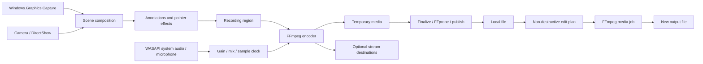

# Architecture

The UI and capture pipeline run on Windows. The application does not need a backend service for local recording or editing.

## Projects

- **Core**: recording state, input validation, scene/annotation models, edit ranges, history and pixel operations. No WPF dependency.
- **Windows**: WGC/D3D11 capture, WASAPI audio, DirectShow camera process, encoder lifecycle, probing, recovery and network jobs.
- **Recorder**: WPF views, MVVM commands, camera guide, capture-area selection, scene sessions, annotation canvas, player and editor.

## Recording lifecycle

`Idle → Starting → Recording ⇄ Paused → Stopping → Finalizing → Completed`.

Preparation, pause and finalization count as busy states. Updates wait for an idle state; a restarted preview never resumes recording automatically. Failure retains diagnostic and recovery material instead of publishing a partial file as successful.

Screen capture keeps a bounded latest-frame buffer. The recorder writes complete raw frames and uses a constant-frame-rate clock. Scene layers are composed within the final recording region so a crop cannot silently remove the camera overlay. Annotations and pointer coordinates remain relative to the capture source.

Audio uses device capture, resampling, independent gains and a bounded buffer. Paused input is discarded; resume clears buffered input. A recovery audio copy uses RF64. Camera, audio and screen capture are separate paths: no single API is responsible for the entire recorder.

FFmpeg runs as a separate process. Media edits and recovery export a new temporary output, validate it, then publish a new file. Recovery cannot reconstruct missing key data.

## Network and local data

Network tasks start only when requested. Stream addresses are validated; keys are not saved to settings and paths are redacted in logs. Network process status is not proof of successful reception: check the receiving endpoint.

Default settings/logs: `%LOCALAPPDATA%/Mimicraft/Recorder/`. Default recordings: the user's Windows Videos folder, under `Mimicraft Recorder`. Capture regions, temporary annotations, pending schedules and stream keys are not restored across launches.
